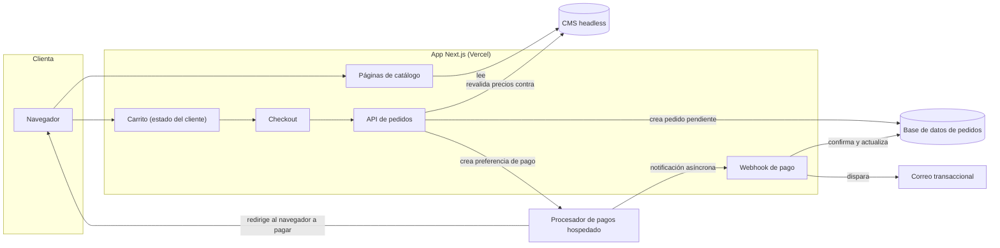
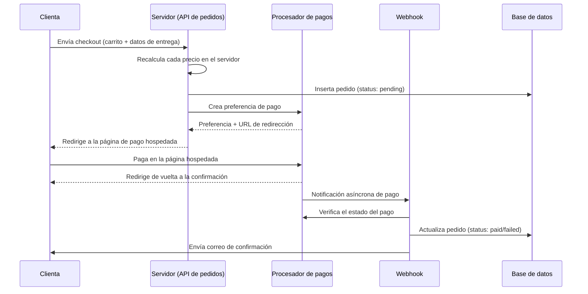
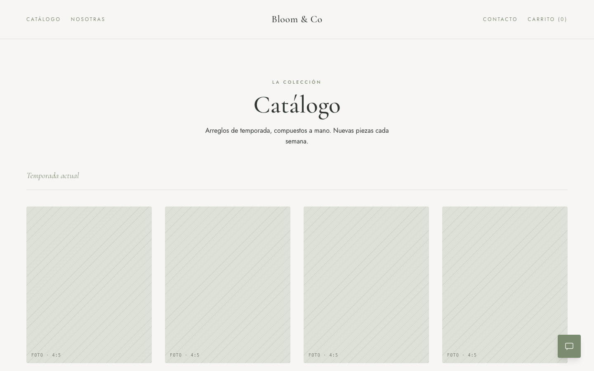
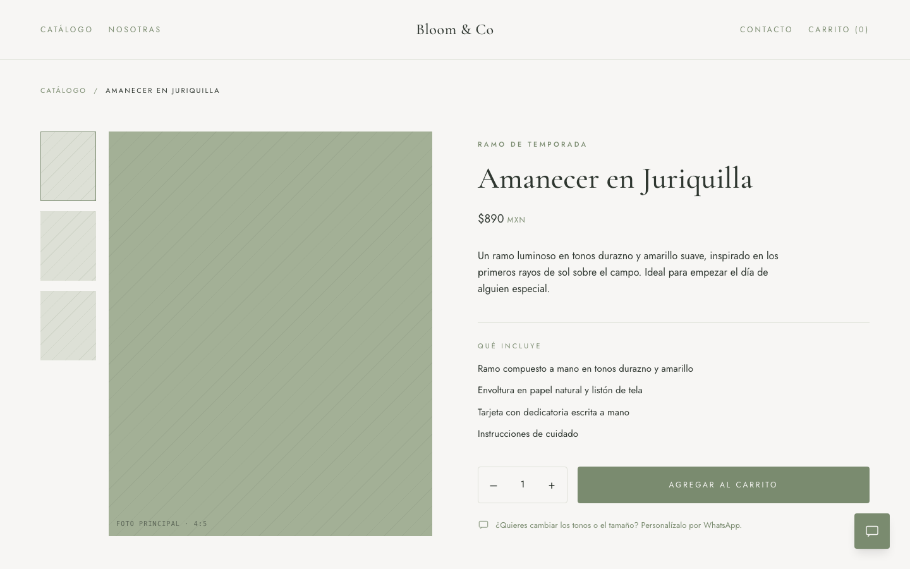
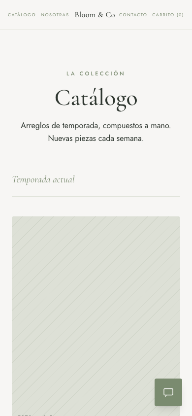

<!-- prettier-ignore -->
> English version: [README.md](README.md)

# Bloom & Co — Case Study

> **Sitio en producción:** [bloom-co-xi.vercel.app](https://bloom-co-xi.vercel.app)

Esto es un case study. El código fuente es privado, pertenece al cliente y
no se publica aquí. Lo que sigue es el problema de negocio, la arquitectura
y las decisiones de diseño detrás de un sitio de e-commerce real, en
producción, para una florería boutique en Querétaro, México.

## TL;DR

- Un negocio de dos personas que vendía exclusivamente por mensajes de chat
  manuales pasó a una tienda de autoservicio con checkout real y pagos en
  línea.
- Stack: Next.js (App Router), TypeScript, Tailwind CSS, un CMS headless
  (catálogo), una base de datos relacional (pedidos) y un procesador de
  pagos hospedado (Checkout Pro, flujo de redirección) — desplegado en
  Vercel.
- El checkout no requiere crear una cuenta; el catálogo lo editan las
  dueñas sin tocar código; la confirmación del pago la dispara un webhook,
  no el redirect del navegador.
- Los arreglos personalizados y hechos a la medida se mantienen a propósito
  fuera del flujo de checkout y se canalizan por WhatsApp — ver [Decisión:
  WhatsApp para pedidos personalizados](docs/06-custom-orders.md).

## El problema

El negocio operaba enteramente por una app de mensajería: una clienta
mandaba una foto que le gustaba, las dueñas confirmaban disponibilidad y
precio a mano, negociaban los detalles de entrega de ida y vuelta, y solo
entonces pedían el pago por una transferencia o link aparte. Esto
funcionaba con bajo volumen, pero cada paso dependía de que alguien
estuviera disponible para contestar en tiempo real, la disponibilidad
nunca era visible para la clienta de antemano, y el cobro era un traspaso
manual y propenso a errores, sin ningún registro que ligara un pedido
específico a un pago específico.

El objetivo no era eliminar esa relación conversacional — es parte de la
marca — sino sacarla de la parte del embudo donde era pura fricción:
explorar un catálogo fijo, confirmar un precio y pagar. Ver [El problema de
negocio](docs/01-problem-space.md) para el desglose completo de qué podía
y qué no podía hacer el flujo anterior.

## Arquitectura

La app en sí es un único despliegue de Next.js sin un backend separado:
las páginas de catálogo se renderizan en servidor desde el CMS, el carrito
es estado del lado del cliente, y todo lo que toca dinero (creación de
pedidos, recálculo de precios, webhook de pago) corre en manejadores de
ruta del servidor. Ver [Arquitectura](docs/02-architecture.md) para el
desglose a nivel de módulos y por qué un solo framework full-stack tuvo
sentido para un proyecto de este tamaño.

## Decisión clave: checkout sin cuenta

No hay cuenta de usuario, login ni contraseña en ninguna parte del flujo.
Una clienta llena sus datos de entrega y contacto al momento del checkout,
y eso es todo el "perfil" que existe.

**Trade-off:** esto renuncia a un historial de pedidos visible para la
clienta y a cualquier noción de perfil de clienta recurrente del lado del
cliente. Para una tienda donde la mayoría de las compras son regalos de
una sola vez, el cálculo fue que cada campo obligatorio antes de pagar es
una oportunidad de abandonar el carrito, y crear una cuenta es exactamente
ese tipo de campo. El razonamiento completo, incluyendo lo que esto le
cuesta operativamente al negocio, está en [Checkout sin
cuenta](docs/03-guest-checkout.md).

## Decisión clave: CMS headless para autonomía de la clienta

El catálogo — nombres, precios, fotos, descripciones, qué está destacado
en un momento dado — vive en un CMS headless, no en el código. Las dos
dueñas pueden agregar un arreglo nuevo, retirar uno o actualizar un precio
ellas mismas, sin un despliegue y sin pedirle nada a un desarrollador. Ver
[CMS headless para autonomía de la clienta](docs/04-headless-cms.md) para
por qué esto importó más que la alternativa (un catálogo definido en
código, que hubiera sido más simple de construir).

## Flujo de pago

La propiedad importante aquí es que **el redirect del navegador de vuelta
al sitio no es lo que confirma el pago** — es una cortesía para la
clienta. El webhook es el único camino que cambia el status de un pedido,
lo que significa que la página de confirmación tiene que funcionar
correctamente sin importar si el webhook ya llegó o no. Ver [Flujo de
pago](docs/05-payment-flow.md) para qué pasa cuando el webhook llega tarde,
y por qué la inserción inicial del pedido nunca confía en un solo número
que venga del navegador.

## Los pedidos personalizados se quedan en WhatsApp

Los arreglos hechos a la medida y muy personalizados explícitamente no se
venden por el flujo de catálogo/checkout — se canalizan a un botón de
WhatsApp presente en todas las pantallas. Ver [Por qué los pedidos
personalizados van por WhatsApp](docs/06-custom-orders.md) para por qué un
formulario rígido hubiera sido la herramienta equivocada para cómo compra
realmente este segmento de clientas.

## Capturas

Vistas de escritorio y móvil del sitio en producción — home, catálogo y
una página de arreglo individual. Toda la fotografía es un placeholder; al
momento de escribir esto la clienta todavía no había subido fotos reales
de producto.

| Home | Catálogo | Arreglo |
|---|---|---|
|  |  |  |

Vistas móviles

| Home | Catálogo | Arreglo |
|---|---|---|
|  |  |  |

## Qué haría diferente

Concreto, no diplomático — ver [Aprendizajes](docs/07-lessons-learned.md)
para el detalle completo, pero la versión corta:

1. Diseñaría el contrato de precios del pedido (el cliente manda solo
   identificadores, el servidor calcula cada precio) desde el primer
   commit del checkout, en vez de llegar a eso como una corrección después
   de que una revisión marcó la versión original que confiaba en el
   cliente.
2. Pondría una suite de pruebas real alrededor de la lógica de precios y
   descuentos antes de tocar pagos siquiera — es la única parte de este
   código donde un error de cálculo significa cobrarle a alguien el monto
   equivocado.
3. Presupuestaría por adelantado tiempo de revisión/negociación con las
   cuentas de prueba del procesador de pagos — la brecha entre
   "credenciales de prueba" que se ven correctas y las que de verdad
   funcionan desde un servidor costó tiempo real.

## Docs

- [01 — El problema de negocio](docs/01-problem-space.md)
- [02 — Arquitectura](docs/02-architecture.md)
- [03 — Checkout sin cuenta](docs/03-guest-checkout.md)
- [04 — CMS headless para autonomía de la clienta](docs/04-headless-cms.md)
- [05 — Flujo de pago](docs/05-payment-flow.md)
- [06 — Por qué los pedidos personalizados van por WhatsApp](docs/06-custom-orders.md)
- [07 — Aprendizajes](docs/07-lessons-learned.md)
