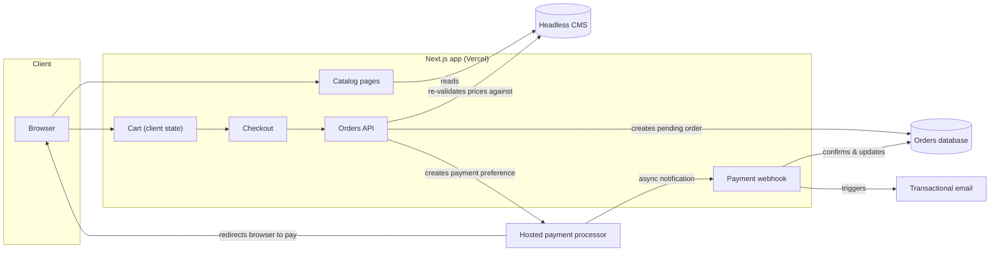
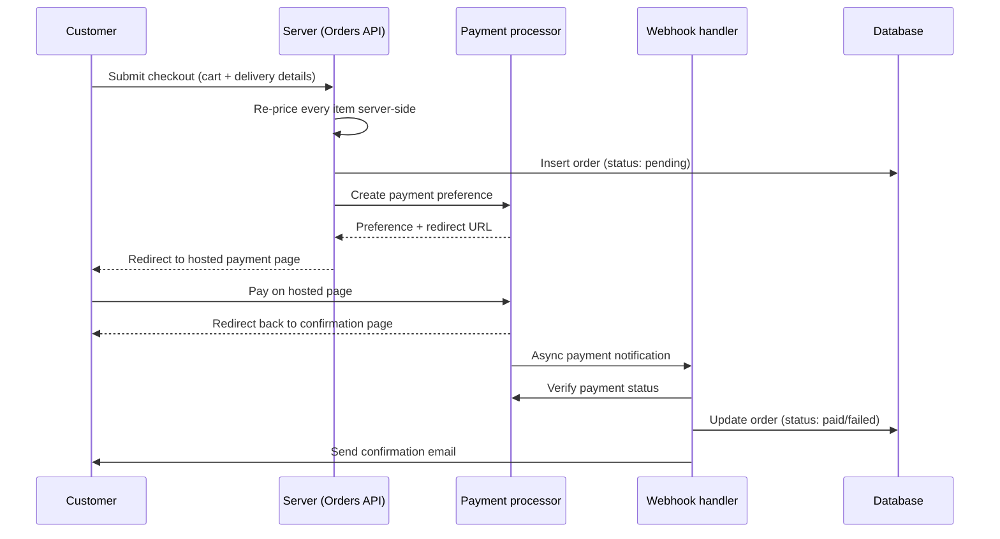
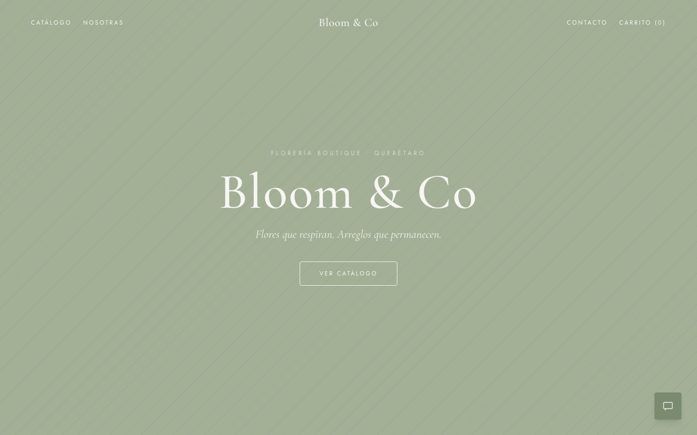
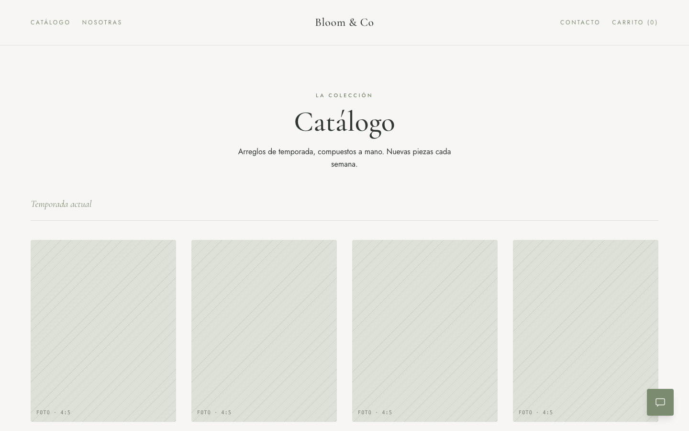
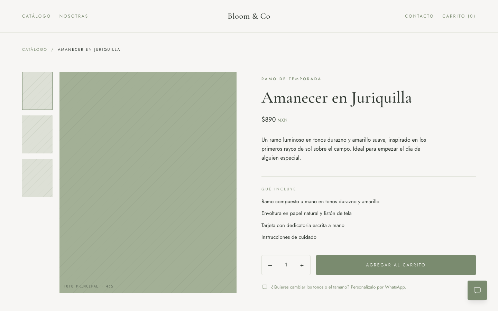
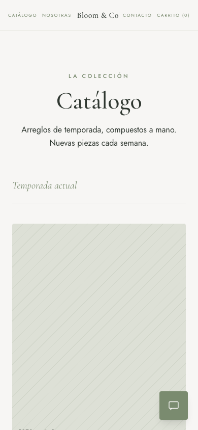
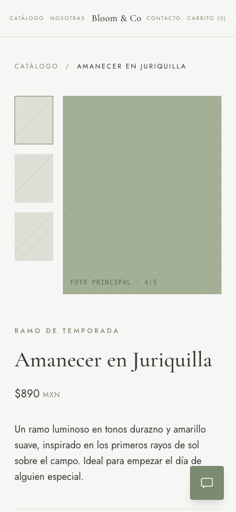

<!-- prettier-ignore -->
> Versión en español: [README.es.md](README.es.md)

# Bloom & Co — Case Study

> **Live site:** [bloom-co-xi.vercel.app](https://bloom-co-xi.vercel.app)

This is a case study. The source code is private, owned by the client, and
not published here. What follows is the business problem, the architecture,
and the design decisions behind a real, production e-commerce site for a
boutique flower shop in Querétaro, Mexico.

## TL;DR

- A two-person floral business that sold exclusively through manual chat
  messages moved to a self-service storefront with a real checkout and
  online payments.
- Stack: Next.js (App Router), TypeScript, Tailwind CSS, a headless CMS
  (catalog), a relational database (orders), and a hosted payment processor
  (Checkout Pro, redirect flow) — deployed on Vercel.
- Checkout requires no account creation; the catalog is editable by the
  owners without touching code; payment confirmation is driven by a
  webhook, not the browser redirect.
- Custom, made-to-order arrangements are deliberately kept outside the
  checkout flow and routed to WhatsApp — see [Decision: WhatsApp for custom
  orders](docs/06-custom-orders.md).

## The problem

The shop ran entirely through a messaging app: a customer would message a
photo they liked, the owners would confirm availability and price by hand,
negotiate delivery details back and forth, and only then request payment
via a separate transfer or link. This worked at low volume, but every step
depended on someone being available to answer in real time, availability
was never visible to the customer up front, and payment collection was a
manual, error-prone hand-off with no record tying a specific order to a
specific payment.

The goal was not to replace that conversational relationship — it's part
of the brand — but to remove it from the part of the funnel where it was
pure friction: browsing a fixed catalog, confirming a price, and paying.
See [The problem space](docs/01-problem-space.md) for the full breakdown of
what the old flow could and couldn't do.

## Architecture

The app itself is a single Next.js deployment with no separate backend
service: catalog pages are server-rendered from the CMS, the cart is
client-side state, and everything that touches money (order creation,
price recalculation, payment webhook) runs in server-side route handlers.
See [Architecture](docs/02-architecture.md) for the module-level breakdown
and why a single full-stack framework made sense for a project this size.

## Key decision: guest checkout

There is no user account, login, or password anywhere in the flow. A
customer fills in delivery and contact details at checkout time and that's
the entire "profile" that exists.

**Trade-off:** this gives up a customer-facing order history and any
notion of a returning-customer profile on the client side. For a shop
where most purchases are one-off gifts, the calculus was that every
required field before payment is a chance to abandon the cart, and account
creation is exactly that kind of field. The full reasoning, including what
this costs the business operationally, is in
[Guest checkout](docs/03-guest-checkout.md).

## Key decision: headless CMS for client autonomy

The catalog — names, prices, photos, descriptions, what's currently
featured — lives in a headless CMS, not in the codebase. The two owners
can add a new arrangement, retire one, or update a price themselves,
without a deploy and without asking a developer. See [Headless CMS for
client autonomy](docs/04-headless-cms.md) for why this mattered more than
the alternative (a code-and-deploy catalog, which would have been simpler
to build).

## Payment flow

The important property here is that **the browser redirect back to the
site is not what confirms the payment** — it's a courtesy for the
customer. The webhook is the only path that changes an order's status,
which means the confirmation page has to work correctly whether the
webhook already arrived or not. See [Payment flow](docs/05-payment-flow.md)
for what happens when the webhook is late, and why the initial order
insert never trusts a single number coming from the browser.

## Custom orders stay on WhatsApp

Made-to-order and highly customized arrangements are explicitly not sold
through the catalog/checkout flow — they're routed to a WhatsApp button
present on every screen. See [Why custom orders go through
WhatsApp](docs/06-custom-orders.md) for why a rigid form would have been
the wrong tool for how this segment of customers actually buys.

## Screenshots

Desktop and mobile views of the production site — home, catalog, and an
individual arrangement page. All photography is placeholder art; the
client had not yet supplied real product photos at the time of writing.

| Home | Catalog | Arrangement |
|---|---|---|
|  |  |  |

Mobile views

| Home | Catalog | Arrangement |
|---|---|---|
|  |  |  |

## What I'd do differently

Concrete, not diplomatic — see [Lessons learned](docs/07-lessons-learned.md)
for the full write-up, but the short version:

1. I'd design the order-pricing contract (client sends identifiers only,
   server computes every price) from the first commit of checkout, instead
   of arriving at it as a fix after a review flagged the original
   client-trusted version.
2. I'd put a real test suite around the pricing and discount math before
   touching payments at all — it's the one part of this codebase where an
   off-by-one is a customer being charged the wrong amount.
3. I'd budget review/negotiation time with the payment processor's sandbox
   accounts up front — the gap between "test credentials" that look right
   and ones that actually work from a server cost real time.

## Docs

- [01 — The problem space](docs/01-problem-space.md)
- [02 — Architecture](docs/02-architecture.md)
- [03 — Guest checkout](docs/03-guest-checkout.md)
- [04 — Headless CMS for client autonomy](docs/04-headless-cms.md)
- [05 — Payment flow](docs/05-payment-flow.md)
- [06 — Why custom orders go through WhatsApp](docs/06-custom-orders.md)
- [07 — Lessons learned](docs/07-lessons-learned.md)
