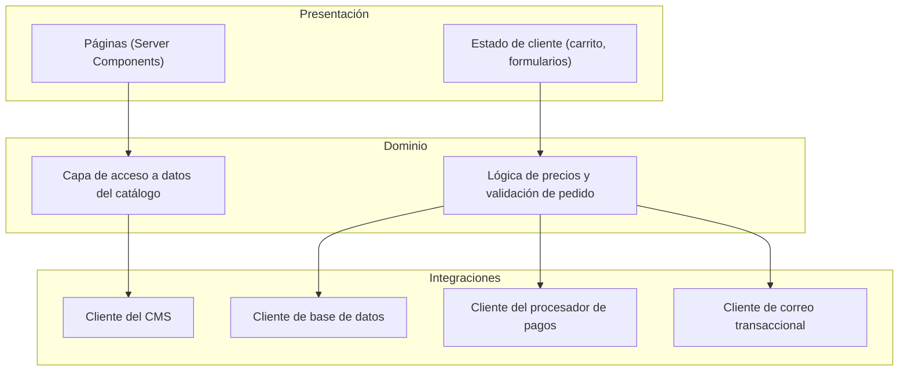

# 02 — Arquitectura

## Por qué un solo framework full-stack

El equipo de desarrollo es una persona y el negocio son dos. No había
justificación para un backend separado, una cola de mensajes, ni
microservicios: la complejidad operativa de mantener varios servicios
desplegados por separado hubiera superado por mucho el problema que
resolvían. Next.js con App Router permite tener páginas renderizadas en
servidor, rutas de API y lógica de servidor dentro de un único proyecto,
con un único comando de despliegue. Esa decisión se revisita solo si el
tráfico o el equipo crecen a un punto donde separar preocupaciones
compense el costo operativo — no antes.

## Capas

- **Presentación**: páginas de catálogo son Server Components que leen
  directo de la capa de datos en cada request (sin caché propia más allá
  de la que da el framework); el carrito y los formularios de checkout son
  estado de cliente porque no necesitan persistir en servidor hasta que se
  confirma un pedido.
- **Dominio**: toda regla de negocio (qué cuenta como una zona de envío
  válida, cómo se calcula un descuento, qué hace que un pedido sea válido
  para cobrar) vive en funciones puras del lado del servidor, separadas de
  los clientes de integración que las usan. Esto es lo que permite que la
  ruta de creación de pedidos sea auditable: la lógica de precios no está
  entreverada con el código que habla con el procesador de pagos.
- **Integraciones**: cada servicio externo (CMS, base de datos, procesador
  de pagos, correo) tiene un único punto de entrada en el código. Ningún
  otro módulo importa el SDK de un proveedor directamente.

## Un patrón deliberado: inicialización perezosa de clientes externos

Cada cliente de integración (base de datos, procesador de pagos) se
construye **dentro** de la función que lo usa, nunca a nivel de módulo. La
razón es operativa, no estética: en un entorno serverless, un cliente
construido a nivel de módulo se instancia en cuanto el módulo se importa —
incluyendo en tiempo de build, o en rutas que ni siquiera necesitan ese
cliente. Si la variable de entorno correspondiente no está presente en ese
momento (un escenario real durante builds o en entornos de preview mal
configurados), el build completo falla por un servicio que esa ruta
específica ni siquiera usa. Construirlo perezosamente, solo cuando la
función que lo necesita efectivamente se ejecuta, aísla esa falla al
único camino de código que depende de esa credencial.

## Flujo de datos: de catálogo a pedido pagado

1. Una página de catálogo pide al CMS la lista de arreglos disponibles en
   tiempo de request.
2. El carrito guarda en el cliente solo identificadores y cantidades — no
   guarda precios como fuente de verdad, precisamente porque un precio de
   catálogo puede cambiar entre que alguien lo agrega al carrito y paga.
3. Al confirmar el checkout, el servidor vuelve a resolver cada
   identificador contra el CMS, recalcula cada precio, y solo entonces
   arma el pedido. Ver [05-payment-flow.md](05-payment-flow.md) para el
   porqué de esto en detalle.
4. El pedido se guarda como un snapshot independiente en la base de datos:
   una vez creado, no vuelve a depender de que el catálogo siga teniendo
   ese arreglo, ese precio o siquiera de que el arreglo siga existiendo.
   Esto importa porque el catálogo es editable en cualquier momento por
   las dueñas — un pedido histórico no debería cambiar de precio
   retroactivamente porque alguien actualizó el catálogo.

## Por qué no un backend separado

La alternativa considerada — una API independiente detrás del frontend —
hubiera tenido sentido si el negocio necesitara exponer esa API a otros
consumidores (una app móvil, un panel administrativo separado, un sistema
de terceros). Ninguno de esos casos existe hoy, y añadir esa separación de
antemano solo hubiera introducido una frontera de red y un despliegue
adicional sin ningún consumidor real del otro lado.
